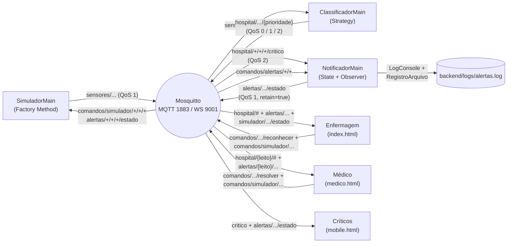
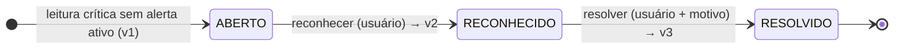

# Monitoramento hospitalar com IoT e MQTT

Sistema acadêmico em Java que simula a coleta contínua de sinais vitais em cinco leitos fictícios (**frequência cardíaca**, **temperatura**, **saturação de oxigênio** e **pressão arterial**), classifica a gravidade das medições em tempo real, gerencia o ciclo de atendimento de alertas críticos e exibe o acompanhamento em três painéis web sincronizados via **Mosquitto (MQTT e WebSocket)**.

> **Navegação rápida:** [Arquitetura](#visão-geral-da-arquitetura) · [Como executar](#execução-completa-do-sistema) · [Roteiro de demonstração](#roteiro-de-demonstração-ponta-a-ponta) · [Três telas (Etapa 6)](#as-três-telas-etapa-6) · [Cinco padrões](#os-cinco-padrões-de-software-no-codigo) · [Testes (147 casos)](#testes-automatizados-junit--147-casos) · [Estrutura e pacotes](#estrutura-do-projeto-e-pacotes-java) · [Limitações e queda do broker](#limitações-conhecidas-e-ensaio-de-queda-do-broker) · [Validações por terminal](#validações-isoladas-por-terminal-etapas-1-a-5) · [Ambiente](#ambiente-utilizado)

---

## Visão geral da arquitetura

Os módulos não se chamam diretamente entre si: toda comunicação entre os três serviços Java e as três páginas web passa pelo broker **Eclipse Mosquitto** (TCP na porta `1883` para o Java e WebSocket na porta `9001` para os navegadores).



### Três conceitos separados no sistema

Para evitar mistura entre o estado do sensor e o ciclo de atendimento, o projeto separa três conceitos:

| Conceito | Quem decide | Valores possíveis | O que representa |
| --- | --- | --- | --- |
| **Prioridade da leitura** | Classificador (**Strategy**) | `ROTINA`, `ATENCAO`, `CRITICO` | Gravidade de uma coleta individual naquele instante. |
| **Condição atual do leito** | Painel web (últimos 10 s) | `ROTINA`, `ATENCAO`, `CRITICO` | Maior gravidade entre as leituras recentes dos quatro sinais daquele leito. |
| **Estado do alerta** | Notificador (**State**) | `ABERTO`, `RECONHECIDO`, `RESOLVIDO` | Situação do atendimento de uma ocorrência crítica por par `(pacienteId, tipoSinal)`. |

---

## Execução completa do sistema

> **Importante:** todos os comandos abaixo partem da **pasta raiz do código** (o diretório que contém este `README.md`, o `docker-compose.yml`, `backend/` e `frontend/`).

### Pré-requisitos

- **Docker Desktop** em execução.
- **JDK** compatível com compilação Java 17 (testado com OpenJDK 25.0.5 LTS) e **Maven** no `PATH` (`mvn -version`).
- Navegador moderno e um servidor HTTP local para o `frontend/` (extensão **Live Server** do VS Code ou `python -m http.server`).

### Ordem de inicialização (5 passos)

**1. Terminal 1 — Subir o broker Mosquitto (na raiz do projeto):**

```powershell
docker compose up -d mosquitto
docker compose ps
```

> Se quiser limpar estados retidos de execuções anteriores antes de iniciar uma demonstração, execute `docker compose restart mosquitto` (o broker usa `persistence false`).

**2. Terminal 2 — Iniciar o Notificador (aguarde `Notificador pronto`):**

```powershell
Set-Location .\backend
mvn compile exec:java "-Dexec.mainClass=br.cefetrj.iot.notificador.NotificadorMain"
```

**3. Terminal 3 — Iniciar o Classificador (aguarde `Classificador pronto`):**

```powershell
Set-Location .\backend
mvn compile exec:java "-Dexec.mainClass=br.cefetrj.iot.classificador.ClassificadorMain"
```

**4. Terminal 4 — Iniciar o Simulador (aguarde `Controle MQTT ativo`):**

```powershell
Set-Location .\backend
mvn compile exec:java "-Dexec.mainClass=br.cefetrj.iot.sensores.SimuladorMain"
```

O simulador publica os cinco leitos a cada **1,5 s** (20 leituras por rodada): `uti/leito-01` (`PAC-101`), `uti/leito-02` (`PAC-102`), `enfermaria/leito-03` (`PAC-201`), `enfermaria/leito-04` (`PAC-202`) e `enfermaria/leito-05` (`PAC-203`).

**5. Servir as páginas web:**

- **Opção 1 (VS Code Live Server):** clique com o botão direito em [frontend/index.html](frontend/index.html) → **Open with Live Server**. O arquivo [.vscode/settings.json](.vscode/settings.json) já está configurado para ignorar `**/backend/**` e `**/*.log`, evitando recarregamentos automáticos quando o notificador grava em `backend/logs/alertas.log`.
- **Opção 2 (Terminal 5 — Python na raiz do projeto):**

```powershell
python -m http.server 5500 -d frontend
```

| Tela | Arquivo | URL padrão (porta 5500) |
| --- | --- | --- |
| Painel de enfermagem | [frontend/index.html](frontend/index.html) | `http://localhost:5500/index.html` (ou `/frontend/index.html` no Live Server da raiz) |
| Painel médico | [frontend/medico.html](frontend/medico.html) | `http://localhost:5500/medico.html` |
| Painel móvel de críticos | [frontend/mobile.html](frontend/mobile.html) | `http://localhost:5500/mobile.html` |
| Teste mínimo WebSocket (Etapa 1) | [frontend/teste-ws.html](frontend/teste-ws.html) | `http://localhost:5500/teste-ws.html` |

> Para testar em um **celular na mesma rede**, abra o endereço usando o IP do computador no lugar de `localhost`; os scripts em [conexao-mqtt.js](frontend/js/conexao-mqtt.js) já conectam em `ws://${location.hostname}:9001`.

### Roteiro de demonstração ponta a ponta

1. Abra **Enfermagem**, **Médico** e **Críticos** em três abas (ou janelas lado a lado). Confira o status `Conectado` e o selo único `Dados simulados` no cabeçalho.
2. Em **Enfermagem** ou **Médico**, expanda **"Área de demonstração · Controle do simulador"**, selecione um leito (ex.: `PAC-101 · UTI · Leito 01`) e um sinal (ex.: `Frequência`) e clique em **Provocar crise**. *(Também funciona digitando `crise leito-01 frequencia` no terminal do simulador.)*
3. Observe nas três telas:
   - O cartão do leito fica **Crítico** com resumo do alerta ativo (`1 alerta ativo: Frequência (ABERTO)`).
   - No **Painel médico**, o **Histórico de coletas** registra imediatamente um cartão `Evento crítico · Frequência` e segue gerando cartões consolidados a cada **5 segundos**.
   - Em **Críticos**, o quadro superior **"Sinais críticos em andamento"** exibe o sinal ao vivo e o andamento em `ABERTO`.
4. Na aba **Enfermagem**, clique em **Reconhecer**, informe o profissional (ex.: `enf-01`) e confirme:
   - O alerta passa para **`RECONHECIDO`** nas três telas simultaneamente (confirmado pelo notificador e registrado no console e em `backend/logs/alertas.log`).
   - O `SimuladorMain`, que também assina `alertas/+/+/+/estado`, inicia automaticamente uma **recuperação gradual de 15 segundos** apenas naquele leito e sinal (`Crítico` → `Atenção` amarelo → `Rotina` verde).
   - Enquanto ainda está em `Crítico` ou `Atenção`, o botão **Registrar resolução** no **Painel médico** permanece desabilitado com aviso explicativo.
5. Assim que o sinal entra em `Rotina` (~15 s, ou antes caso clique em **Simular recuperação (Rotina)** na área de demonstração), o botão **Registrar resolução** acende em verde no **Painel médico**:
   - Clique em **Registrar resolução**, informe o médico (ex.: `med-01`) e o motivo (com sugestão dinâmica baseada no valor e horário da origem).
   - O alerta vai para **`RESOLVIDO`** nas três telas com a linha do tempo completa (abertura, reconhecimento e resolução), e nenhuma nova ocorrência reabre.
6. Para demonstrar **múltiplos sinais críticos no mesmo leito**, provoque `Frequência` e `Pressão` no `Leito 01`, reconheça e resolva apenas um deles e observe que cada sinal mantém seu próprio ciclo e cartão independente enquanto o leito permanece em crise pelo outro sinal.

### Encerramento e limpeza entre demonstrações

- No **Simulador** (Terminal 4): digite `sair` e pressione `Enter`.
- No **Classificador** e no **Notificador** (Terminais 3 e 2): pressione `Enter`.
- No **Broker** (Terminal 1, na raiz): execute `docker compose down`.

---

## As três telas (Etapa 6)

Cada painel assina apenas os tópicos pertinentes ao seu papel (via WebSocket no Mosquitto, usando o pacote local [mqtt.min.js](frontend/js/vendor/mqtt.min.js) para funcionar sem acesso à internet) e possui fluxo exclusivo de ação:

| Painel | Assinaturas MQTT | Papel e ações na interface | Recursos implementados |
| --- | --- | --- | --- |
| **Enfermagem** ([index.html](frontend/index.html)) | `hospital/#`, `alertas/+/+/+/estado`, `respostas/alertas/+/+`, `simulador/+/+/estado` | Visão geral dos 5 leitos; destaca alertas `ABERTO` no topo e permite **apenas `Reconhecer`**. | Resumo de alertas ativos no cartão de cada leito; área de demonstração do simulador; indicador de leitura desatualizada (> 10 s). |
| **Médico** ([medico.html](frontend/medico.html)) | `hospital/{ala}/{leito}/#`, `alertas/{ala}/{leito}/+/estado`, `respostas/alertas/+/+`, `simulador/+/+/estado` | Foco em um paciente/leito por vez (troca cancela a assinatura anterior); permite **apenas `Registrar resolução`** e somente depois que o sinal volta à `ROTINA`. | Leito selecionado e **Histórico de coletas** salvos no `sessionStorage`; cartões a cada 5 s com destaque amarelo/vermelho, evento crítico imediato, preenchimento de sinais da mesma rodada, scroll preservado e botão `Limpar histórico`. |
| **Críticos** ([mobile.html](frontend/mobile.html)) | `hospital/+/+/+/critico`, `alertas/+/+/+/estado` | **Somente acompanhamento** em tempo real do andamento (`ABERTO`, `RECONHECIDO`, `RESOLVIDO`) e horários/responsáveis (sem modal nem botões de ação). | Quadro superior **"Sinais críticos em andamento"** exibindo todos os sinais com alerta ativo ao mesmo tempo; seção de resolvidos aberta por padrão. |

### Organização do front-end

A lógica compartilhada está concentrada em dois módulos principais (sem frameworks externos):

- [frontend/js/conexao-mqtt.js](frontend/js/conexao-mqtt.js): gerencia a conexão WebSocket, aguarda confirmação de assinatura (`SUBACK`) antes de liberar ações, alterna filtros ao trocar de paciente e publica comandos de alerta e do simulador.
- [frontend/js/painel.js](frontend/js/painel.js): renderiza leituras, histórico em cartões de 5 s, linha do tempo dos alertas, trava realista de resolução, área de demonstração do simulador e controle de modal.
- [frontend/js/enfermagem.js](frontend/js/enfermagem.js), [frontend/js/medico.js](frontend/js/medico.js) e [frontend/js/mobile.js](frontend/js/mobile.js): inicializam `iniciarPainel(...)` com o perfil de cada página.
- [frontend/css/estilos.css](frontend/css/estilos.css): estilos responsivos, selo único `Dados simulados`, destaques por prioridade e linha do tempo.

---

## Os cinco padrões de software no código

| Padrão | Onde está | Classes principais | Papel na arquitetura |
| --- | --- | --- | --- |
| **Publish-Subscribe** | Broker + contratos + 3 serviços + telas | [Topicos](backend/src/main/java/br/cefetrj/iot/contrato/Topicos.java), [ClienteMqtt](backend/src/main/java/br/cefetrj/iot/mqtt/ClienteMqtt.java), [conexao-mqtt.js](frontend/js/conexao-mqtt.js) | Desacopla produtores e consumidores; nenhum serviço chama outro diretamente. |
| **Factory Method** | Pacote `sensores` | [PublicadorSensor](backend/src/main/java/br/cefetrj/iot/sensores/PublicadorSensor.java), [Sensor](backend/src/main/java/br/cefetrj/iot/sensores/Sensor.java) e 4 publicadores/sensores concretos | Delega às subclasses qual `Sensor` concreto instanciar via `criarSensor()`. |
| **Strategy** | Pacote `classificador` | [RegraClassificacao](backend/src/main/java/br/cefetrj/iot/classificador/RegraClassificacao.java), [ServicoClassificador](backend/src/main/java/br/cefetrj/iot/classificador/ServicoClassificador.java) e 4 `Regra*` | Seleciona a estratégia de faixa clínica pelo `TipoSinal`, sem `if/switch` monolítico no serviço. |
| **State** | Pacote `notificador.estado` | [ContextoAlerta](backend/src/main/java/br/cefetrj/iot/notificador/estado/ContextoAlerta.java), [EstadoAlerta](backend/src/main/java/br/cefetrj/iot/notificador/estado/EstadoAlerta.java), `AlertaAberto`, `AlertaReconhecido`, `AlertaResolvido` | Garante transições válidas do alerta em objetos de estado e rejeita ações proibidas. |
| **Observer** | Pacote `notificador` | [CentralAlertas](backend/src/main/java/br/cefetrj/iot/notificador/CentralAlertas.java), [ObservadorAlerta](backend/src/main/java/br/cefetrj/iot/notificador/ObservadorAlerta.java), [LogConsole](backend/src/main/java/br/cefetrj/iot/notificador/LogConsole.java), [RegistroArquivo](backend/src/main/java/br/cefetrj/iot/notificador/RegistroArquivo.java) | Notifica múltiplos observadores locais em cada abertura e transição aceita. |

### 1. Publish-Subscribe e contrato MQTT

As mensagens trafegam em JSON UTF-8 validadas por [ConversorJson](backend/src/main/java/br/cefetrj/iot/contrato/ConversorJson.java) e endereçadas exclusivamente por [Topicos](backend/src/main/java/br/cefetrj/iot/contrato/Topicos.java) (detalhes completos no [contrato MQTT](contrato.md)).

| Mensagem | Tópico | Quem publica | Quem assina | QoS publicado | Retain |
| --- | --- | --- | --- | :---: | :---: |
| Leitura bruta (`Leitura`) | `sensores/{ala}/{leito}/{sinal}` | Simulador | Classificador (`sensores/#`, QoS 1) | 1 | Não |
| Leitura classificada (`Leitura`) | `hospital/{ala}/{leito}/{sinal}/{prioridade}` | Classificador | Enfermagem, Médico e, nos críticos, Notificador (`QoS 2`) e Críticos (`QoS 2`) | `0` rotina, `1` atenção, `2` crítico | Não |
| Comando de alerta (`ComandoAlerta`) | `comandos/alertas/{idAlerta}/{acao}` | Enfermagem / Médico | Notificador (`comandos/alertas/+/+`, QoS 1) | 1 | Não |
| Estado do alerta (`Alerta`) | `alertas/{ala}/{leito}/{idAlerta}/estado` | Notificador | Enfermagem, Médico, Críticos e Simulador (para rampa de 15 s) | 1 | Sim |
| Resposta de comando (`ResultadoComando`) | `respostas/alertas/{idAlerta}/{idComando}` | Notificador | Enfermagem / Médico (`respostas/alertas/+/+`, QoS 1) | 1 | Não |
| Controle do simulador (`ComandoSimulador`) | `comandos/simulador/{ala}/{leito}/{sinal}` | Enfermagem / Médico | Simulador (`comandos/simulador/+/+/+`, QoS 1) | 1 | Não |
| Estado do simulador (`EstadoSimulador`) | `simulador/{ala}/{leito}/estado` | Simulador | Enfermagem / Médico (`simulador/+/+/estado`, QoS 1) | 1 | Sim |

### 2. Factory Method (pacote `sensores`)

- **Criador abstrato:** [PublicadorSensor](backend/src/main/java/br/cefetrj/iot/sensores/PublicadorSensor.java) declara `public abstract Sensor criarSensor()` e implementa `publicar(leito)`, que coleta a leitura pela interface [Sensor](backend/src/main/java/br/cefetrj/iot/sensores/Sensor.java), serializa em JSON e publica com QoS 1 e `retain = false`.
- **Criadores e produtos concretos:** `PublicadorFrequencia` (`SensorFrequencia`), `PublicadorTemperatura` (`SensorTemperatura`), `PublicadorSaturacao` (`SensorSaturacao`) e `PublicadorPressao` (`SensorPressao`).
- **Controle de crise e recuperação de 15 s:** [LeitoSimulado](backend/src/main/java/br/cefetrj/iot/sensores/LeitoSimulado.java) e [ControladorSimulador](backend/src/main/java/br/cefetrj/iot/sensores/ControladorSimulador.java) aceitam comandos pelo console e por MQTT (`ROTINA` ou `CRISE`). Quando o simulador recebe ao vivo um `Alerta` em `RECONHECIDO` posterior ao início da crise atual, os sensores reduzem/normalizam gradualmente o valor ao longo de **15 segundos** (`CRITICO` → `ATENCAO` → `ROTINA`) antes de retornar à faixa normal.

### 3. Strategy (pacote `classificador`)

[ServicoClassificador](backend/src/main/java/br/cefetrj/iot/classificador/ServicoClassificador.java) mantém um `EnumMap<TipoSinal, RegraClassificacao>` com [RegraFrequencia](backend/src/main/java/br/cefetrj/iot/classificador/RegraFrequencia.java), [RegraTemperatura](backend/src/main/java/br/cefetrj/iot/classificador/RegraTemperatura.java), [RegraSaturacao](backend/src/main/java/br/cefetrj/iot/classificador/RegraSaturacao.java) e [RegraPressao](backend/src/main/java/br/cefetrj/iot/classificador/RegraPressao.java). Também mantém um cache LRU em memória com capacidade padrão de **1.024 `idLeitura`** para suprimir republicações duplicadas por QoS 1.

| Medida | `ROTINA` (QoS 0) | `ATENCAO` (QoS 1) | `CRITICO` (QoS 2) |
| --- | --- | --- | --- |
| Frequência cardíaca (`bpm`) | `60 ≤ x ≤ 100` | `50 ≤ x < 60` ou `100 < x ≤ 120` | `x < 50` ou `x > 120` |
| Temperatura (`°C`) | `36,0 ≤ x ≤ 37,5` | `35,0 < x < 36,0` ou `37,5 < x < 39,0` | `x ≤ 35,0` ou `x ≥ 39,0` |
| Saturação (`%`) | `x ≥ 95` | `90 ≤ x < 95` | `x < 90` |
| Pressão sistólica (`mmHg`) | `90 ≤ x ≤ 139` | `80 ≤ x < 90` ou `139 < x < 180` | `x < 80` ou `x ≥ 180` |
| Pressão diastólica (`mmHg`) | `60 ≤ x ≤ 89` | `50 ≤ x < 60` ou `89 < x < 120` | `x < 50` ou `x ≥ 120` |

> Na pressão arterial, sistólica e diastólica chegam no mesmo evento JSON e `RegraPressao` prevalece pela componente mais grave, detalhando no `motivo` qual componente (ou ambas) determinou a prioridade.

### 4. State (pacote `notificador.estado`)

[ProcessadorComandos](backend/src/main/java/br/cefetrj/iot/notificador/ProcessadorComandos.java) serializa leituras críticas e comandos em uma única thread de fila (`notificador-fila`). Um novo crítico para um par `(pacienteId, tipoSinal)` sem alerta ativo abre um alerta `ABERTO` (versão 1); críticos subsequentes enquanto ativo ficam agrupados na mesma ocorrência.



[ContextoAlerta](backend/src/main/java/br/cefetrj/iot/notificador/estado/ContextoAlerta.java) delega `reconhecer(...)` e `resolver(...)` para a implementação corrente de [EstadoAlerta](backend/src/main/java/br/cefetrj/iot/notificador/estado/EstadoAlerta.java) ([AlertaAberto](backend/src/main/java/br/cefetrj/iot/notificador/estado/AlertaAberto.java), [AlertaReconhecido](backend/src/main/java/br/cefetrj/iot/notificador/estado/AlertaReconhecido.java) e [AlertaResolvido](backend/src/main/java/br/cefetrj/iot/notificador/estado/AlertaResolvido.java)). Ações fora de ordem lançam `TransicaoAlertaInvalidaException`, retornam `REJEITADO` com `TRANSICAO_INVALIDA` (ou `ALERTA_INEXISTENTE` se o ID não existir) e preservam estado e versão.

### 5. Observer (pacote `notificador`)

[NotificadorMain](backend/src/main/java/br/cefetrj/iot/notificador/NotificadorMain.java) registra [LogConsole](backend/src/main/java/br/cefetrj/iot/notificador/LogConsole.java) e [RegistroArquivo](backend/src/main/java/br/cefetrj/iot/notificador/RegistroArquivo.java) em [CentralAlertas](backend/src/main/java/br/cefetrj/iot/notificador/CentralAlertas.java). Em cada abertura e transição aceita, a central entrega um [EventoAlerta](backend/src/main/java/br/cefetrj/iot/contrato/EventoAlerta.java) (estado anterior + retrato atual + instante do notificador) a todos os observadores registrados, isolando eventuais falhas individuais de um observador.

---

## Testes automatizados (JUnit — 147 casos)

Os testes rodam sem o broker ligado (usando publicadores em memória e diretórios temporários):

```powershell
Set-Location .\backend
mvn clean test
```

| Classe de teste | Casos | O que verifica |
| --- | ---: | --- |
| [TopicosTest](backend/src/test/java/br/cefetrj/iot/contrato/TopicosTest.java) | 5 | Montagem e normalização de todas as famílias de tópicos (incluindo simulador) e QoS por prioridade. |
| [ConversorJsonTest](backend/src/test/java/br/cefetrj/iot/contrato/ConversorJsonTest.java) | 7 | Ida e volta Java ↔ JSON ↔ Java (incluindo pressão e comandos/estados do simulador) e rejeição de entradas inválidas. |
| [PublicadorSensorTest](backend/src/test/java/br/cefetrj/iot/sensores/PublicadorSensorTest.java) | 4 | Factory Method por publicador, contrato das leituras, troca de modo por leito/sinal e rampa gradual de 15 s (`CRITICO → ATENCAO → ROTINA`). |
| [ControladorSimuladorTest](backend/src/test/java/br/cefetrj/iot/sensores/ControladorSimuladorTest.java) | 7 | Estados iniciais retidos, comandos MQTT do simulador, rampa ao receber `RECONHECIDO` e descarte de retidos antigos ou inválidos. |
| [RegrasClassificacaoTest](backend/src/test/java/br/cefetrj/iot/classificador/RegrasClassificacaoTest.java) | 75 | Limites abaixo, iguais e acima de cada faixa nos quatro sinais e prevalência na pressão. |
| [ServicoClassificadorTest](backend/src/test/java/br/cefetrj/iot/classificador/ServicoClassificadorTest.java) | 21 | Roteamento das 12 combinações sinal × prioridade, motivos de pressão, cache LRU, falha de envio e concorrência. |
| [ContextoAlertaTest](backend/src/test/java/br/cefetrj/iot/notificador/estado/ContextoAlertaTest.java) | 13 | Abertura, versões, dados de origem, transições válidas/inválidas e proteção concorrente no State. |
| [CentralAlertasTest](backend/src/test/java/br/cefetrj/iot/notificador/CentralAlertasTest.java) | 4 | Cadastro/remoção de observadores, isolamento de falhas e auditoria completa no console e em arquivo. |
| [ProcessadorComandosTest](backend/src/test/java/br/cefetrj/iot/notificador/ProcessadorComandosTest.java) | 11 | Agrupamento por paciente/sinal, reentrega, fila ordenada, publicação estado → resposta, novas tentativas e encerramento. |
| **Total** | **147** | `Failures: 0`, `Errors: 0`, `Skipped: 0` |

Comandos para rodar grupos específicos em `backend/`:

```powershell
mvn "-Dtest=TopicosTest,ConversorJsonTest" test
mvn "-Dtest=PublicadorSensorTest,ControladorSimuladorTest" test
mvn "-Dtest=RegrasClassificacaoTest,ServicoClassificadorTest" test
mvn "-Dtest=ContextoAlertaTest,CentralAlertasTest,ProcessadorComandosTest" test
```

---

## Estrutura do projeto e pacotes Java

```text
├── .vscode/settings.json       # Ignora backend/** e *.log no Live Server
├── backend/
│   ├── logs/alertas.log        # Auditoria local gravada pelo RegistroArquivo
│   ├── pom.xml                 # Java 17, Eclipse Paho, Gson e JUnit 5
│   └── src/
│       ├── main/java/br/cefetrj/iot/
│       └── test/java/br/cefetrj/iot/
├── frontend/
│   ├── index.html              # Painel de enfermagem
│   ├── medico.html             # Painel médico por paciente
│   ├── mobile.html             # Painel móvel de alertas críticos
│   ├── teste-ws.html           # Página mínima da Etapa 1 (teste/#)
│   ├── css/estilos.css
│   └── js/
│       ├── vendor/mqtt.min.js  # MQTT.js 5.16.1 offline
│       ├── conexao-mqtt.js
│       ├── painel.js
│       ├── enfermagem.js
│       ├── medico.js
│       └── mobile.js
├── mosquitto/config/mosquitto.conf
├── docker-compose.yml
├── contrato.md                 # Contrato oficial de tópicos e payloads JSON
└── README.md
```

| Pacote Java | Responsabilidade |
| --- | --- |
| [br.cefetrj.iot.contrato](backend/src/main/java/br/cefetrj/iot/contrato) | Records imutáveis (`Leitura`, `Alerta`, `ComandoAlerta`, `ResultadoComando`, `ComandoSimulador`, `EstadoSimulador`, `EventoAlerta`), enums, `Topicos` e `ConversorJson`. |
| [br.cefetrj.iot.mqtt](backend/src/main/java/br/cefetrj/iot/mqtt) | `ConfiguracaoMqtt`, `ClienteMqtt` (reconexão automática e reassinatura) e `ReceptorMensagemMqtt`. |
| [br.cefetrj.iot.sensores](backend/src/main/java/br/cefetrj/iot/sensores) | `SimuladorMain`, `LeitoSimulado`, `ControladorSimulador`, `PublicadorSensor`, `Sensor` e implementações concretas (Factory Method). |
| [br.cefetrj.iot.classificador](backend/src/main/java/br/cefetrj/iot/classificador) | `ClassificadorMain`, `ServicoClassificador`, `RegraClassificacao` e estratégias por sinal (Strategy). |
| [br.cefetrj.iot.notificador](backend/src/main/java/br/cefetrj/iot/notificador) | `NotificadorMain`, `ProcessadorComandos`, `CentralAlertas`, `ObservadorAlerta`, `LogConsole` e `RegistroArquivo` (Observer). |
| [br.cefetrj.iot.notificador.estado](backend/src/main/java/br/cefetrj/iot/notificador/estado) | `ContextoAlerta`, `EstadoAlerta`, `AlertaAberto`, `AlertaReconhecido` e `AlertaResolvido` (State). |
| [br.cefetrj.iot.demo](backend/src/main/java/br/cefetrj/iot/demo) | Programas de verificação das etapas iniciais (`PublicadorTesteMain`, `AssinanteTesteMain`, `ConferirContratoMain`). |

---

## Limitações conhecidas e ensaio de queda do broker

- **Estado em memória no notificador:** se `NotificadorMain` for reiniciado, os alertas ativos em memória são perdidos; eventuais mensagens retidas que restarem no broker receberão `ALERTA_INEXISTENTE` ao tentar transicionar. A auditoria já gravada permanece em `backend/logs/alertas.log`.
- **Broker sem persistência em disco:** [mosquitto.conf](mosquitto/config/mosquitto.conf) define `persistence false` e `allow_anonymous true` para fins exclusivos de demonstração acadêmica. Reiniciar o container limpa os estados retidos.
- **Reenvio após timeout na interface (`incerto / reenviar`):** se um comando enviado pelas telas ficar mais de **8 segundos** sem resposta, a interface habilita o botão *"Reenviar mesmo comando"*. Como o notificador não mantém tabela de idempotência por `idComando`, caso o pedido original já tenha sido aplicado e apenas a resposta tenha se perdido, o reenvio é protegido pelo padrão **State** e devolve `REJEITADO` com `TRANSICAO_INVALIDA`, sem alterar nem corromper o alerta.
- **Histórico na sessão do navegador:** como não há banco de dados (fora do escopo), as leituras (`retain = false`) exibidas no histórico de coletas do Painel médico ficam armazenadas no `sessionStorage` da aba por leito.
- **Dados fictícios e segurança:** não há autenticação real (`usuarioId` apenas identifica um profissional fictício) nem TLS.

### Ensaio de queda e retomada do broker

Com o sistema completo em execução e as telas conectadas, simule a queda e a volta do Mosquitto na raiz do projeto:

```powershell
docker compose stop mosquitto
```

Observe as telas exibirem **`Sem conexão`** (desabilitando os botões de ação e do simulador) e os três programas Java registrarem a perda de conexão no console. Em seguida, religue o broker:

```powershell
docker compose start mosquitto
```

Verifique que os três serviços Java e as páginas web reconectam, refazem as assinaturas automaticamente e retomam o fluxo de leituras e alertas. *(Leituras publicadas enquanto o broker estava parado são perdidas, pois o simulador não armazena buffer offline.)*

#### Resultado confirmado na Etapa 7 (20/11/2026)

| Etapa do ensaio | Comportamento observado |
| --- | --- |
| **Queda do broker** (`22:59`, `docker compose stop mosquitto`, `1,3 s`) | `NotificadorMain` e `ClassificadorMain` registraram `Conexão MQTT perdida. Aguardando reconexão.` e permaneceram ativos. `SimuladorMain` registrou `Falha ao publicar leitura ...: O cliente não está conectado`. As telas mudaram para **`Sem conexão`** e `Sem coleta recente`. |
| **Retomada do broker** (`23:00`–`23:01`, `docker compose start mosquitto`, `1,4 s`) | O navegador (MQTT.js, intervalo fixo de `1,5 s`) voltou a **`Conectado`** imediatamente. `NotificadorMain` restaurou `hospital/+/+/+/critico` e `comandos/alertas/+/+`; `ClassificadorMain` restaurou `sensores/#` (reconexão automática do Eclipse Paho com espera progressiva). Em seguida, os valores numéricos dos quatro sinais voltaram a atualizar normalmente nas telas. |
| **Perdas confirmadas** | Leituras geradas durante a parada (sem buffer offline no simulador) e estados retidos no broker (`persistence false`). |

---

## Validações isoladas por terminal (Etapas 1 a 5)

<details>
<summary>Expandir roteiros originais de terminal (Etapas 1 a 5)</summary>

### Etapa 1 — Fundação e WebSocket

1. Abra [frontend/teste-ws.html](frontend/teste-ws.html) via servidor HTTP local e aguarde `Pronto para receber em teste/#`.
2. Em `backend/`: `mvn compile exec:java "-Dexec.mainClass=br.cefetrj.iot.demo.AssinanteTesteMain"`.
3. Em outro terminal em `backend/`: `mvn compile exec:java "-Dexec.mainClass=br.cefetrj.iot.demo.PublicadorTesteMain"`.
4. Confira a leitura de `P003` (`128 bpm`) no assinante Java e na página web.

### Etapa 2 — Contrato e cliente MQTT

1. Terminal A em `backend/`: `mvn compile exec:java "-Dexec.mainClass=br.cefetrj.iot.demo.ConferirContratoMain" "-Dexec.args=ouvir"`.
2. Terminal B em `backend/`: `mvn compile exec:java "-Dexec.mainClass=br.cefetrj.iot.demo.ConferirContratoMain" "-Dexec.args=publicar"`.
3. Confira o recebimento de `PAC-101` em `sensores/uti/leito-01/pressao` com `sistolica=185` e `diastolica=110`.

### Etapa 3 — Simulador isolado

1. Na raiz: `docker compose up -d mosquitto` e `docker compose exec mosquitto mosquitto_sub -t 'sensores/#' -q 1 -v`.
2. Em `backend/`: `mvn compile exec:java "-Dexec.mainClass=br.cefetrj.iot.sensores.SimuladorMain"`.
3. No prompt `>`, teste `status`, `crise leito-01 frequencia` e `rotina leito-01 frequencia`.

### Etapa 4 — Simulador e classificador com leitura manual

1. Na raiz: `docker compose exec mosquitto mosquitto_sub -q 2 -t 'sensores/uti/leito-01/frequencia' -t 'hospital/uti/leito-01/frequencia/+' -F 'qos=%q %t %p'`.
2. Em `backend/`: `mvn compile exec:java "-Dexec.mainClass=br.cefetrj.iot.classificador.ClassificadorMain"`.
3. Na raiz, publique `110 bpm` (atenção):

```powershell
$leitura = [ordered]@{
    idLeitura      = [guid]::NewGuid().ToString()
    pacienteId     = 'PAC-101'
    ala            = 'uti'
    leito          = 'leito-01'
    tipoSinal      = 'FREQUENCIA'
    unidade        = 'bpm'
    instanteColeta = [DateTimeOffset]::Now.ToString('o')
    valor          = 110
    sistolica      = $null
    diastolica     = $null
    prioridade     = $null
    motivo         = $null
}
$json = $leitura | ConvertTo-Json -Compress
$json | docker compose exec -T mosquitto mosquitto_pub -q 1 -t 'sensores/uti/leito-01/frequencia' -s
```

Confira saída em `hospital/uti/leito-01/frequencia/atencao` com motivo `Frequência cardíaca na faixa de atenção`. Reenviar a última linha com o mesmo `idLeitura` é suprimido pelo cache do classificador.

### Etapa 5 — Ciclo de alertas no notificador via CLI

Com broker, `NotificadorMain`, `ClassificadorMain` e `SimuladorMain` em execução:

1. Acompanhe o leito 01 na raiz:

```powershell
docker compose exec mosquitto mosquitto_sub -V mqttv311 -d -R -q 2 -t 'hospital/uti/leito-01/frequencia/+' -t 'alertas/uti/leito-01/+/estado' -t 'respostas/alertas/+/+' -F 'qos=%q retido=%r %t %p'
```

2. No simulador, digite `crise leito-01 frequencia`, copie o `idAlerta` impresso e volte com `rotina leito-01 frequencia`.
3. Envie comandos manuais em PowerShell na raiz para conferir rejeição e ciclo completo:

```powershell
$OutputEncoding = [System.Text.UTF8Encoding]::new($false)
function Enviar-ComandoAlerta([string]$Alerta, [string]$Acao, [string]$Usuario, [string]$Motivo) {
    $idComando = 'cmd-' + [guid]::NewGuid().ToString('N')
    $pedido = @{
        idComando       = $idComando
        idAlerta        = $Alerta
        acao            = $Acao.ToUpperInvariant()
        usuarioId       = $Usuario
        instanteComando = [DateTimeOffset]::Now.ToString('o')
    }
    if ($Acao -eq 'resolver') { $pedido['motivoResolucao'] = $Motivo }
    $json = $pedido | ConvertTo-Json -Compress
    $json | docker compose exec -T mosquitto mosquitto_pub -V mqttv311 -q 1 -t "comandos/alertas/$Alerta/$Acao" -s
    if ($LASTEXITCODE -ne 0) { throw "Falha ao publicar o comando $idComando" }
    Write-Host "Resposta em respostas/alertas/$Alerta/$idComando"
}

$idAlerta = (Read-Host 'Cole o idAlerta').Trim()
Enviar-ComandoAlerta $idAlerta 'resolver'   'med-01' 'Tentativa antes do reconhecimento'
Enviar-ComandoAlerta $idAlerta 'reconhecer' 'enf-01'
Enviar-ComandoAlerta $idAlerta 'resolver'   'med-01' 'Frequência estabilizada após atendimento'
Enviar-ComandoAlerta 'alt-inexistente' 'reconhecer' 'enf-01'
```

</details>

---

## Ambiente utilizado

| Componente | Versão ou configuração testada |
| --- | --- |
| Sistema operacional | Windows 10 (`amd64`) |
| JDK | OpenJDK `25.0.5` LTS (`Temurin 25.0.5+8`), compilando com target Java 17 (`maven.compiler.release=17`) |
| Maven | Apache Maven `3.10.1` (`compiler 3.14.1`, `surefire 3.5.4`, `exec 3.7.0`) |
| Docker Compose | `v5.7.0` (Docker Desktop) |
| Broker MQTT | Imagem `eclipse-mosquitto:2` (MQTT `1883`, WebSocket `9001`) |
| Dependências Java | Eclipse Paho `1.2.5`, Gson `2.11.0`, JUnit `5.10.2` |
| Front-end | `MQTT.js 5.16.1` incluído localmente em [frontend/js/vendor/mqtt.min.js](frontend/js/vendor/mqtt.min.js) |
| Git | `2.49.0.windows.1` |
