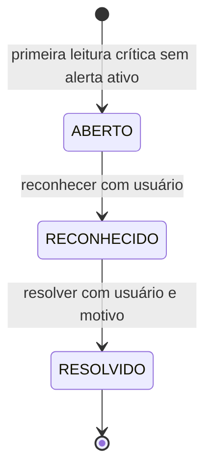

# Monitoramento hospitalar com IoT

Projeto acadêmico em Java que simula frequência cardíaca, temperatura, saturação e pressão arterial em cinco leitos fictícios. O simulador publica cada coleta. O classificador acrescenta uma prioridade (`ROTINA`, `ATENCAO` ou `CRITICO`) e um motivo, preservando o ID, o horário, o paciente e as medidas de origem. Na Etapa 5, o notificador abre alertas para ocorrências críticas. O profissional pode reconhecê-los e resolvê-los por MQTT e consultar o histórico do atendimento.

O Mosquitto encaminha as mensagens aos assinantes de cada tópico (**Publish-Subscribe**). Cada publicador cria seu sensor com **Factory Method**. O classificador usa **Strategy** para escolher a regra do sinal. No notificador, **State** define quais ações o alerta aceita em cada estado e **Observer** registra a abertura e as transições no console e em arquivo.

[Executar a Etapa 5](#testar-o-ciclo-do-leito-01) · [Tópicos MQTT](#como-o-projeto-usa-publish-subscribe) · [Testes automatizados](#testes-automatizados) · [Executar a Etapa 4](#executar-o-simulador-e-o-classificador-etapa-4) · [Resultados confirmados da Etapa 4](#resultados-confirmados-no-leito-01) · [Ambiente utilizado](#ambiente-utilizado)

## Etapa 5 — Notificador com State e Observer

Se o classificador publicar uma frequência crítica de `PAC-101` na UTI, o notificador abre uma ocorrência com um `idAlerta` próprio. O alerta guarda o `idLeituraOrigem`, o horário da coleta, a medida, a unidade, o motivo da classificação e o leito de origem. O mesmo `idAlerta` acompanha o atendimento até a resolução.



**State.** `ContextoAlerta` delega `reconhecer` e `resolver` ao objeto que representa o estado atual. `AlertaAberto` aceita o reconhecimento, `AlertaReconhecido` aceita a resolução e `AlertaResolvido` é terminal. Uma ação proibida preserva o estado e a versão. O notificador registra quem executou cada ação aceita e usa o próprio relógio para datar a abertura, o reconhecimento e a resolução. [Contexto e estados concretos](backend/src/main/java/br/cefetrj/iot/notificador/estado) · [State no Refactoring.Guru](https://refactoring.guru/design-patterns/state)

**Observer.** `NotificadorMain` registra `LogConsole` e `RegistroArquivo` na `CentralAlertas`. Na abertura e em cada transição aceita, a central chama `ObservadorAlerta.atualizar(EventoAlerta)` em cada observador. O primeiro escreve no console do notificador. O segundo acrescenta uma linha a `codigo/backend/logs/alertas.log` quando o serviço roda em `codigo/backend`. O evento local contém o estado anterior e o alerta atualizado. Pelo MQTT, o notificador publica o registro `Alerta` completo para quem assina o tópico de estado. [Central de alertas](backend/src/main/java/br/cefetrj/iot/notificador/CentralAlertas.java) · [Registro em arquivo](backend/src/main/java/br/cefetrj/iot/notificador/RegistroArquivo.java) · [Observer no Refactoring.Guru](https://refactoring.guru/design-patterns/observer)

**Por que uma crise gera uma única abertura?** `ProcessadorComandos` trata leituras e comandos em uma fila. Enquanto houver um alerta `ABERTO` ou `RECONHECIDO` para o mesmo par `(pacienteId, tipoSinal)`, novas medições críticas desse par mantêm a ocorrência e a versão atuais, mesmo que o paciente mude de leito. Outro sinal pode abrir seu próprio alerta. Voltar a `ROTINA` mantém o atendimento em andamento. Depois da resolução, uma leitura crítica com `idLeitura` inédito pode abrir uma nova ocorrência. A reentrega de uma leitura já vista é ignorada durante a execução. [Processamento de leituras e comandos](backend/src/main/java/br/cefetrj/iot/notificador/ProcessadorComandos.java)

### Testar o ciclo do leito 01

Abra o Docker Desktop e quatro terminais PowerShell na raiz `monitoramento-hospitalar`, a pasta que contém `codigo`. Use um JDK que compile para Java 17 e o Maven no `PATH` (`mvn -version`). Inicie uma instância de cada programa. O terminal 4 primeiro simula o paciente e depois envia os comandos do profissional.

**1. Terminal 1 — iniciar o broker e observar o leito.** Execute na ordem abaixo e aguarde a confirmação de assinatura (`SUBACK`). As linhas que começam por `qos=` trazem o tópico e o JSON. A opção `-R` oculta os estados de rodadas anteriores que o broker reenviaria ao assinar.

```powershell
Set-Location .\codigo
docker compose up -d mosquitto
docker compose ps
docker compose exec mosquitto mosquitto_sub -V mqttv311 -d -R -q 2 -t 'hospital/uti/leito-01/frequencia/+' -t 'alertas/uti/leito-01/+/estado' -t 'respostas/alertas/+/+' -F 'qos=%q retido=%r %t %p'
```

**2. Terminais 2 e 3 — iniciar os dois serviços.** No terminal 2, execute o notificador e aguarde `Notificador pronto`.

```powershell
Set-Location .\codigo\backend
mvn compile exec:java "-Dexec.mainClass=br.cefetrj.iot.notificador.NotificadorMain"
```

No terminal 3, execute o classificador e aguarde `Classificador pronto`. Mantenha os dois serviços em execução até o fim do ensaio.

```powershell
Set-Location .\codigo\backend
mvn compile exec:java "-Dexec.mainClass=br.cefetrj.iot.classificador.ClassificadorMain"
```

**3. Terminal 4 — provocar uma crise e identificar o alerta.** Inicie o simulador.

```powershell
Set-Location .\codigo\backend
mvn compile exec:java "-Dexec.mainClass=br.cefetrj.iot.sensores.SimuladorMain"
```

1. No prompt `>` do simulador, digite `crise leito-01 frequencia`. No terminal 1, procure a saída `/critico` e o alerta `ABERTO`, versão 1, de `PAC-101`. Copie o valor do campo **`idAlerta`**, que começa por `alt-`.
2. Aguarde mais uma leitura crítica. Ela chega com outro `idLeitura`, enquanto a mesma ocorrência permanece aberta. No terminal 2, o console deve mostrar uma única abertura para esse alerta.
3. Digite `rotina leito-01 frequencia`. Espere a próxima leitura `/rotina` no terminal 1 e então digite `sair` no terminal 4. Isso evita que uma crise ainda em andamento abra outra ocorrência logo após a resolução. O alerta que você copiou continua `ABERTO`.

**4. Terminal 4 — enviar os comandos.** Quando voltar ao prompt `PS`, você estará em `codigo/backend`. Cole o bloco abaixo. Ele muda para `codigo` e prepara uma função que envia um pedido em JSON com QoS 1. Quando aparecer a pergunta, cole apenas o `idAlerta`, sem aspas. Cada chamada à função cria um `idComando` e mostra em qual tópico procurar a resposta.

```powershell
Set-Location ..
$OutputEncoding = [System.Text.UTF8Encoding]::new($false)
function Enviar-ComandoAlerta([string]$Alerta, [string]$Acao, [string]$Usuario, [string]$Motivo) {
    $idComando = 'cmd-' + [guid]::NewGuid().ToString('N')
    $pedido = @{
        idComando       = $idComando
        idAlerta        = $Alerta
        acao            = $Acao.ToUpperInvariant()
        usuarioId       = $Usuario
        instanteComando = [DateTimeOffset]::Now.ToString('o')
    }
    if ($Acao -eq 'resolver') { $pedido['motivoResolucao'] = $Motivo }
    $json = $pedido | ConvertTo-Json -Compress
    $json | docker compose exec -T mosquitto mosquitto_pub -V mqttv311 -q 1 -t "comandos/alertas/$Alerta/$Acao" -s
    if ($LASTEXITCODE -ne 0) { throw "Falha ao publicar o comando $idComando" }
    Write-Host "Resposta em respostas/alertas/$Alerta/$idComando"
}

$idAlerta = (Read-Host 'Cole o idAlerta que apareceu no terminal 1').Trim()
```

Execute **uma linha por vez**. Confira a resposta no terminal 1 antes de enviar a seguinte. A primeira chamada tenta resolver antes do reconhecimento para demonstrar a rejeição.

```powershell
Enviar-ComandoAlerta $idAlerta 'resolver'   'med-01' 'Teste antes do reconhecimento'
Enviar-ComandoAlerta $idAlerta 'reconhecer' 'enf-01'
Enviar-ComandoAlerta $idAlerta 'resolver'   'med-01' 'Atendimento simulado concluído'
Enviar-ComandoAlerta 'alt-inexistente' 'reconhecer' 'enf-01'
```

| Pedido                             | Resposta esperada no MQTT                                           | Efeito na auditoria do alerta                                         |
| ---------------------------------- | ------------------------------------------------------------------- | --------------------------------------------------------------------- |
| Resolver ainda `ABERTO`            | `REJEITADO`, motivo `TRANSICAO_INVALIDA`, estado `ABERTO`, versão 1 | Mantém apenas a abertura.                                             |
| Reconhecer como `enf-01`           | `APLICADO`, estado `RECONHECIDO`, versão 2                          | Registra quem reconheceu e quando.                                    |
| Resolver como `med-01`, com motivo | `APLICADO`, estado `RESOLVIDO`, versão 3                            | Preserva o reconhecimento e registra quem resolveu, quando e por quê. |
| Reconhecer um ID inexistente       | `REJEITADO`, motivo `ALERTA_INEXISTENTE`, estado e versão nulos     | Nenhum evento.                                                        |

**5. Terminal 4 — conferir o estado retido e o histórico.** Assine o tópico exato do alerta depois da resolução. Essa nova assinatura deve receber imediatamente `retido=1`, QoS 1 e o JSON `RESOLVIDO` na versão 3. O terminal 1 pode ter mostrado `retido=0` ao receber a mesma publicação ao vivo.

```powershell
docker compose exec -T mosquitto mosquitto_sub -V mqttv311 -q 1 -t "alertas/uti/leito-01/$idAlerta/estado" -C 1 -W 5 -F 'retido=%r qos=%q %p'
$eventos = @(Select-String -Path .\backend\logs\alertas.log -SimpleMatch $idAlerta)
$eventos.Line
$eventos.Count
```

Espere **três linhas** para o ID escolhido, uma por versão. As duas rejeições do ensaio não geram um novo estado nem uma linha de atendimento. **Limpeza opcional.** Se quiser repetir a demonstração com o Mosquitto ligado, execute o comando abaixo para remover apenas o estado retido deste alerta. O histórico do atendimento continua em codigo/backend/logs/alertas.log.

```powershell
docker compose exec -T mosquitto mosquitto_pub -V mqttv311 -q 1 -r -n -t "alertas/uti/leito-01/$idAlerta/estado"
```

Para encerrar, pressione `Enter` nos terminais 2 e 3, `Ctrl+C` no terminal 1 e execute `docker compose down` no terminal 4, em `codigo`.

## Testes automatizados

Execute a suíte na pasta `codigo/backend`. Os testes capturam as publicações em memória e usam diretórios temporários para conferir a auditoria em arquivo. A suíte pode rodar com o broker desligado.

```powershell
mvn clean test
```

| Etapa                    | Casos | Cobertura                                                                                                                                                                                                                                                   |
| ------------------------ | ----: | ----------------------------------------------------------------------------------------------------------------------------------------------------------------------------------------------------------------------------------------------------------- |
| 2 — Contrato             |    10 | `TopicosTest` (4) verifica tópicos e QoS. `ConversorJsonTest` (6) verifica conversão de mensagens e rejeição de dados inválidos.                                                                                                                            |
| 3 — Sensores             |     3 | `PublicadorSensorTest` verifica o sensor criado por cada publicador, o contrato das leituras e a mudança de modo por sinal e leito.                                                                                                                         |
| 4 — Regras               |    75 | `RegrasClassificacaoTest` verifica as fronteiras de cada faixa, inclusive valores decimais, e a prevalência da componente de pressão mais grave.                                                                                                            |
| 4 — Serviço              |    21 | `ServicoClassificadorTest` verifica as 12 combinações de sinal e prioridade, cinco casos de motivo da pressão e quatro cenários de serviço (cache, falha e reenvio, entrada inválida e concorrência). Inclui tópico, QoS, retenção e preservação dos dados. |
| 5 — Ciclo do alerta      |    13 | `ContextoAlertaTest` cobre abertura, origem da leitura, versões, ações permitidas e proibidas, responsáveis, motivo e concorrência.                                                                                                                         |
| 5 — Observadores         |     4 | `CentralAlertasTest` verifica cadastro e remoção, registro simultâneo, isolamento de falha e as três entradas de auditoria no console e no arquivo.                                                                                                         |
| 5 — Processamento e MQTT |    11 | `ProcessadorComandosTest` verifica agrupamento e reentrega, comandos aceitos e rejeitados, entradas inválidas, ordem da fila, ordem de publicação, novas tentativas e encerramento.                                                                         |

A Etapa 5 acrescenta **28 casos** aos 109 previstos até a Etapa 4. A suíte descrita totaliza **137 casos esperados**, contando cada entrada parametrizada. Confira no resumo do Maven o total efetivamente executado, `Failures: 0`, `Errors: 0`, `Skipped: 0` e `BUILD SUCCESS`. Os resultados manuais já confirmados no leito 01 estão na seção da Etapa 4. O roteiro da Etapa 5 acima indica a saída esperada com o broker real.

Cada linha abaixo executa os testes de uma única etapa.

```powershell
mvn "-Dtest=TopicosTest,ConversorJsonTest" test
mvn "-Dtest=PublicadorSensorTest" test
mvn "-Dtest=RegrasClassificacaoTest,ServicoClassificadorTest" test
mvn "-Dtest=ContextoAlertaTest,CentralAlertasTest,ProcessadorComandosTest" test
```

## Como o projeto usa Publish-Subscribe

No projeto, **publicar** significa enviar uma mensagem JSON ao broker Mosquitto em um tópico MQTT. **Assinar** significa informar ao broker quais tópicos um programa quer acompanhar. Assim, o simulador publica cada coleta uma vez, e tanto o classificador quanto o terminal de observação podem recebê-la. Para acompanhar outro leito, basta mudar o filtro da assinatura.

| Mensagem                                  | Quem publica                    | Tópico da publicação                          | Quem recebe                                                                                                                     | QoS publicado                              | Retida? |
| ----------------------------------------- | ------------------------------- | --------------------------------------------- | ------------------------------------------------------------------------------------------------------------------------------- | ------------------------------------------ | ------- |
| Leitura bruta                             | Simulador de sensores           | `sensores/{ala}/{leito}/{sinal}`              | O classificador assina `sensores/#` com QoS 1. O terminal pode acompanhar um sinal de um leito.                                 | 1                                          | Não     |
| Leitura classificada                      | Classificador                   | `hospital/{ala}/{leito}/{sinal}/{prioridade}` | O notificador assina `hospital/+/+/+/critico` com QoS 2. O terminal pode acompanhar todas as prioridades de um sinal.           | `ROTINA` = 0, `ATENCAO` = 1, `CRITICO` = 2 | Não     |
| Comando do profissional (`ComandoAlerta`) | Terminal de comandos na Etapa 5 | `comandos/alertas/{idAlerta}/{acao}`          | O notificador assina `comandos/alertas/+/+` com QoS 1.                                                                          | 1                                          | Não     |
| Estado atual (`Alerta`)                   | Notificador                     | `alertas/{ala}/{leito}/{idAlerta}/estado`     | O terminal pode assinar um alerta ou todos os estados do leito. Um novo assinante recebe a última versão retida de cada tópico. | 1                                          | Sim     |
| Resposta ao comando (`ResultadoComando`)  | Notificador                     | `respostas/alertas/{idAlerta}/{idComando}`    | O solicitante pode assinar a resposta específica ou acompanhar várias respostas com um filtro.                                  | 1                                          | Não     |

O **classificador exerce os dois papéis na mesma conexão MQTT**. `ClassificadorMain` mantém a assinatura das leituras brutas. A cada entrada válida, `ServicoClassificador` aplica a estratégia do sinal e publica o resultado. O **Strategy** determina a prioridade e o motivo. O **Publish-Subscribe** permite que os demais programas recebam esse resultado pelos tópicos que assinaram.

O **notificador** também assina e publica. O comando leva `reconhecer` ou `resolver` no tópico e `RECONHECER` ou `RESOLVER` no JSON. O `idComando` liga o pedido à resposta. Em uma transição aceita, o notificador avisa os observadores locais, publica o estado com retenção e aguarda a confirmação do envio antes de publicar `APLICADO`. Uma ação proibida gera apenas `REJEITADO` com o motivo e a versão atual. Um comando com tópico e JSON incompatíveis ou conteúdo inválido, como uma resolução sem motivo, é descartado com diagnóstico no console.

[Publicador dos sensores](backend/src/main/java/br/cefetrj/iot/sensores/PublicadorSensor.java) · [Assinatura do classificador](backend/src/main/java/br/cefetrj/iot/classificador/ClassificadorMain.java) · [Publicação da leitura classificada](backend/src/main/java/br/cefetrj/iot/classificador/ServicoClassificador.java) · [Assinaturas do notificador](backend/src/main/java/br/cefetrj/iot/notificador/NotificadorMain.java) · [Contrato MQTT](contrato.md)

## Onde está o Factory Method

No exemplo do Refactoring.Guru, `Dialog` declara `createButton()` e as subclasses escolhem o botão. Aqui, `PublicadorSensor` declara `criarSensor()` e as subclasses escolhem o sensor. [Referência do padrão](https://refactoring.guru/design-patterns/factory-method)

| Papel do padrão     | Implementação na etapa 3                                                                                                   |
| ------------------- | -------------------------------------------------------------------------------------------------------------------------- |
| Criador             | `PublicadorSensor` declara `public abstract Sensor criarSensor()` e implementa `publicar(leito)`.                          |
| Criadores concretos | `PublicadorFrequencia`, `PublicadorTemperatura`, `PublicadorSaturacao` e `PublicadorPressao` sobrescrevem `criarSensor()`. |
| Produto             | A interface `Sensor` define `getTipoSinal()` e `coletar(leito)`.                                                           |
| Produtos concretos  | `SensorFrequencia`, `SensorTemperatura`, `SensorSaturacao` e `SensorPressao` implementam a interface.                      |

Por exemplo, `PublicadorPressao.criarSensor()` devolve um `SensorPressao`. Na primeira publicação, `obterSensor()` chama a fábrica e guarda o sensor. Nas seguintes, o publicador reutiliza essa instância. O método comum `publicar(leito)` coleta a leitura, converte-a em JSON e a envia com QoS 1 e `retain=false`. [Código dos sensores e publicadores](backend/src/main/java/br/cefetrj/iot/sensores)

## Como o classificador usa Strategy

`RegraClassificacao` define `classificar(Leitura)`. `RegraFrequencia`, `RegraTemperatura`, `RegraSaturacao` e `RegraPressao` implementam essa interface. `ServicoClassificador` registra as quatro em um `EnumMap<TipoSinal, RegraClassificacao>`. A cada entrada, `regras.get(leituraBruta.tipoSinal())` escolhe a estratégia e `regra.classificar(leituraBruta)` devolve um `ResultadoClassificacao` com prioridade e motivo. [Código do serviço](backend/src/main/java/br/cefetrj/iot/classificador/ServicoClassificador.java) · [Referência do padrão](https://refactoring.guru/design-patterns/strategy)

As faixas abaixo são regras da simulação acadêmica. `x` representa a medida indicada na linha.

| Medida                    | ROTINA          | ATENCAO                          | CRITICO               |
| ------------------------- | --------------- | -------------------------------- | --------------------- |
| Frequência (bpm)          | `60 ≤ x ≤ 100`  | `50 ≤ x < 60` ou `100 < x ≤ 120` | `x < 50` ou `x > 120` |
| Temperatura (°C)          | `36 ≤ x ≤ 37,5` | `35 < x < 36` ou `37,5 < x < 39` | `x ≤ 35` ou `x ≥ 39`  |
| Saturação (%)             | `x ≥ 95`        | `90 ≤ x < 95`                    | `x < 90`              |
| Pressão sistólica (mmHg)  | `90 ≤ x ≤ 139`  | `80 ≤ x < 90` ou `139 < x < 180` | `x < 80` ou `x ≥ 180` |
| Pressão diastólica (mmHg) | `60 ≤ x ≤ 89`   | `50 ≤ x < 60` ou `89 < x < 120`  | `x < 50` ou `x ≥ 120` |

Para pressão, uma única mensagem contém as duas medidas. Em `185/110`, por exemplo, a sistólica determina `CRITICO` e o motivo indica qual componente levou à classificação. Nos empates de atenção ou de crítico, o motivo cita ambas.

O serviço verifica a compatibilidade entre tópico e JSON com `ConversorJson.lerNoTopico(...)`. Entradas inválidas são registradas e descartadas. As leituras classificadas saem com QoS 0 para `ROTINA`, 1 para `ATENCAO` e 2 para `CRITICO`, sempre com `retain=false`. Depois de um envio bem-sucedido, o serviço guarda o `idLeitura` em um cache em memória com capacidade padrão de 1.024 IDs. Reentregas de um ID ainda presente suprimem nova publicação. Uma falha de envio deixa o ID disponível para nova tentativa caso a entrada seja reenviada. Reiniciar o processo limpa o cache.

## Contrato e módulos

| Pacote Java                         | Responsabilidade                                                                                                                                                                                                                                             |
| ----------------------------------- | ------------------------------------------------------------------------------------------------------------------------------------------------------------------------------------------------------------------------------------------------------------ |
| `br.cefetrj.iot.contrato`           | Define as mensagens `Leitura`, `Alerta`, `ComandoAlerta` e `ResultadoComando`, o evento local `EventoAlerta` e os enums `TipoSinal`, `Prioridade` e `EstadoCicloAlerta`. `Topicos` monta os endereços MQTT e `ConversorJson` valida e converte as mensagens. |
| `br.cefetrj.iot.mqtt`               | `ConfiguracaoMqtt` define os parâmetros de conexão. `ClienteMqtt` publica, assina, reconecta e refaz as assinaturas. `ReceptorMensagemMqtt` entrega a mensagem recebida ao módulo.                                                                           |
| `br.cefetrj.iot.sensores`           | `SimuladorMain` agenda as coletas. `LeitoSimulado` guarda o modo por sinal. Os publicadores criam os sensores e enviam as leituras ao broker.                                                                                                                |
| `br.cefetrj.iot.classificador`      | `ClassificadorMain` assina as leituras brutas. `ServicoClassificador` valida a entrada, aplica a estratégia e publica a leitura classificada.                                                                                                                |
| `br.cefetrj.iot.notificador`        | `NotificadorMain` conecta o serviço e registra os observadores. `ProcessadorComandos` agrupa críticos e processa os comandos em ordem. `CentralAlertas` distribui cada evento local ao console e ao arquivo.                                                 |
| `br.cefetrj.iot.notificador.estado` | `ContextoAlerta` mantém o estado corrente. As implementações de `EstadoAlerta` definem as transições permitidas para cada ocorrência.                                                                                                                        |
| `br.cefetrj.iot.demo`               | Contém os programas de verificação das etapas 1 e 2 descritos abaixo.                                                                                                                                                                                        |

O simulador publica em `sensores/{ala}/{leito}/{sinal}`. Frequência, temperatura e saturação usam o campo `valor`. A pressão usa `sistolica` e `diastolica` na mesma mensagem, com `valor` nulo. Mesmo em `CRISE`, `prioridade` e `motivo` ficam nulos na leitura bruta. [Contrato MQTT e exemplos de JSON](contrato.md)

A Etapa 5 oferece o fluxo completo de reconhecimento e resolução via MQTT. A ligação dos botões **Reconhecer** e **Resolver** das telas de monitoramento a esses tópicos está prevista para a Etapa 6. A página WebSocket da fundação continua servindo ao teste de conexão em `teste/#`.

### O que acontece ao reenviar uma mensagem ou reiniciar o serviço

O notificador guarda em memória os alertas e os IDs de leituras críticas já processadas. O `idComando` permite localizar a resposta. Reenviar um reconhecimento já aplicado pode resultar em `TRANSICAO_INVALIDA`, pois o alerta já avançou. Se ocorrer uma falha de transporte enquanto o serviço estiver ativo, a fila tenta reenviar a mesma publicação antes de prosseguir. Uma perda da confirmação pode duplicar a mensagem no MQTT. Os observadores locais recebem uma chamada por mudança aceita.

Ao reiniciar o notificador, um estado retido pode continuar visível no broker, mas um comando para aquele ID recebe `ALERTA_INEXISTENTE`. O arquivo `logs/alertas.log` conserva o histórico em disco. A configuração `persistence false` também faz o Mosquitto perder os estados retidos quando o próprio broker reinicia.

## Repetir as validações das etapas anteriores

Para as demonstrações das etapas 1 e 2, suba o broker com `docker compose up -d` em `codigo`. Execute os comandos Maven em terminais separados, ambos em `codigo/backend`.

### Etapa 1 — Fundação e WebSocket

1. Abra `frontend/teste-ws.html` com **Live Server** no VS Code e aguarde `Pronto para receber em teste/#`. [Página de teste](frontend/teste-ws.html)
2. Inicie o assinante Java e aguarde a mensagem `Assinante pronto`.

   ```powershell
   mvn compile exec:java "-Dexec.mainClass=br.cefetrj.iot.demo.AssinanteTesteMain"
   ```

3. No segundo terminal, publique a leitura de demonstração.

   ```powershell
   mvn compile exec:java "-Dexec.mainClass=br.cefetrj.iot.demo.PublicadorTesteMain"
   ```

4. Confira a leitura de `P003` com valor `128` bpm no assinante Java e no navegador. A página da fundação assina `teste/#`. Para ver as leituras do simulador, use a assinatura `sensores/#` da etapa 3.

### Etapa 2 — Contrato e cliente MQTT

1. Inicie o assinante e aguarde `Assinante pronto`.

   ```powershell
   mvn compile exec:java "-Dexec.mainClass=br.cefetrj.iot.demo.ConferirContratoMain" "-Dexec.args=ouvir"
   ```

2. No segundo terminal, publique o exemplo de pressão.

   ```powershell
   mvn compile exec:java "-Dexec.mainClass=br.cefetrj.iot.demo.ConferirContratoMain" "-Dexec.args=publicar"
   ```

3. Confira o recebimento de `PAC-101` no tópico `sensores/uti/leito-01/pressao`, com `sistolica=185` e `diastolica=110` no JSON.

Nas demonstrações das etapas 1 e 2, `Enter` encerra o assinante Java. Quando concluir, execute `docker compose down` em `codigo`.

### Etapa 3 — verificar o simulador isoladamente

Abra dois terminais para repetir a validação dos sensores. No primeiro, entre em `codigo`, suba o broker e assine as leituras brutas.

```powershell
docker compose up -d
docker compose exec mosquitto mosquitto_sub -t 'sensores/#' -q 1 -v
```

O segundo terminal executa o simulador. Abra-o em `codigo/backend` e use o comando abaixo.

```powershell
mvn compile exec:java "-Dexec.mainClass=br.cefetrj.iot.sensores.SimuladorMain"
```

No prompt `>`, use `status`, `crise leito-01 frequencia` e `rotina leito-01 frequencia`, aguardando uma coleta entre as mudanças de modo. Na validação original da etapa 3, o assinante recebeu, entre outras, leituras brutas de 143, 142 e 140 bpm para `PAC-101` durante a crise.

Para limitar a saída à frequência do leito 01, pressione `Ctrl+C` no primeiro terminal e assine o tópico desse sinal.

```powershell
docker compose exec mosquitto mosquitto_sub -t 'sensores/uti/leito-01/frequencia' -q 1 -v
```

Digite `sair` no simulador, pressione `Ctrl+C` no assinante e execute `docker compose down` em `codigo` ao concluir.

### Executar o simulador e o classificador (etapa 4)

Use um JDK que compile para Java 17 e tenha o Maven disponível no PowerShell (`mvn -version`). Abra o Docker Desktop e três terminais PowerShell na raiz `monitoramento-hospitalar`, a pasta que contém `codigo`. Comece com o simulador parado para observar uma única coleta antes do fluxo contínuo.

#### Terminal 1 — iniciar o broker e acompanhar o leito 01

```powershell
Set-Location .\codigo
docker compose up -d
docker compose ps
docker compose exec mosquitto mosquitto_sub -q 2 -t 'sensores/uti/leito-01/frequencia' -t 'hospital/uti/leito-01/frequencia/+' -F 'qos=%q %t %p'
```

Confira se o serviço `mosquitto` está em execução. O último comando mantém o terminal aberto, aguardando a frequência cardíaca do leito 01 antes e depois da classificação. O `+` aceita qualquer prioridade no último nível do tópico. A assinatura solicita QoS 2 para permitir observar os três níveis de entrega. Cada linha mostra o QoS recebido, o tópico e o JSON.

#### Terminal 2 — iniciar o classificador

```powershell
Set-Location .\codigo\backend
mvn compile exec:java "-Dexec.mainClass=br.cefetrj.iot.classificador.ClassificadorMain"
```

Aguarde `Classificador pronto` e deixe o programa em execução. Ele assinou `sensores/#` com QoS 1 e publicará em `hospital/{ala}/{leito}/{sinal}/{prioridade}`. As duas publicações do leito observado aparecem no terminal 1.

#### Terminal 3 — enviar uma leitura de 110 bpm e repetir o mesmo ID

```powershell
Set-Location .\codigo
$topico = 'sensores/uti/leito-01/frequencia'
$leitura = [ordered]@{
    idLeitura      = [guid]::NewGuid().ToString()
    pacienteId     = 'PAC-101'
    ala            = 'uti'
    leito          = 'leito-01'
    tipoSinal      = 'FREQUENCIA'
    unidade        = 'bpm'
    instanteColeta = [DateTimeOffset]::Now.ToString('o')
    valor          = 110
    sistolica      = $null
    diastolica     = $null
    prioridade     = $null
    motivo         = $null
}
$json = $leitura | ConvertTo-Json -Compress
$json | docker compose exec -T mosquitto mosquitto_pub -q 1 -t $topico -s
```

Compare `idLeitura` e `instanteColeta` nas duas mensagens do terminal 1. A entrada traz `prioridade` e `motivo` nulos. A saída vai para `hospital/uti/leito-01/frequencia/atencao` com `prioridade=ATENCAO` e o motivo `Frequência cardíaca na faixa de atenção da simulação`.

Para repetir **a mesma coleta**, execute **somente a última linha** do bloco. Executar o bloco inteiro gera outro ID e representa uma nova coleta.

#### Terminal 3 — ligar o simulador e mudar o modo da frequência

Depois da leitura manual, o terminal 3 está em `codigo`. Execute o bloco abaixo nessa pasta. Se for iniciar o simulador diretamente da raiz do repositório, use `Set-Location .\codigo\backend` na primeira linha.

```powershell
Set-Location .\backend
mvn compile exec:java "-Dexec.mainClass=br.cefetrj.iot.sensores.SimuladorMain"
```

O simulador agenda uma rodada a cada 1,5 segundo. Cada rodada completa publica 20 leituras, uma por sinal em cada leito. Os leitos `01` e `02` ficam na UTI e os leitos `03`, `04` e `05` na enfermaria. O paciente e o tópico podem se repetir. Cada nova coleta ganha um `idLeitura` próprio.

Quando aparecer `>`, digite `status`, aplique `crise leito-01 frequencia` e consulte `status` de novo. Aguarde a saída crítica no terminal 1 antes de digitar `rotina leito-01 frequencia`. O comando `ajuda` lista a sintaxe. O argumento `todos` altera os quatro sinais de um leito, como em `crise leito-02 todos` e `rotina leito-02 todos`.

#### Resultados confirmados no leito 01

Os cenários abaixo passaram na validação manual da frequência cardíaca de `PAC-101`, na UTI. O terminal 3 mostrou o modo do sensor. O terminal 1 permitiu conferir a prioridade publicada pelo classificador.

| Ação realizada                           | Resultado observado                                                                                                                                                                                   |
| ---------------------------------------- | ----------------------------------------------------------------------------------------------------------------------------------------------------------------------------------------------------- |
| Enviar 110 bpm                           | A leitura bruta chegou com QoS 1. A saída `/atencao` chegou com QoS 1, prioridade e motivo preenchidos. ID, horário da coleta, paciente e valor coincidiram entre entrada e saída.                    |
| Reenviar o mesmo JSON                    | A entrada apareceu novamente em `sensores/uti/leito-01/frequencia`. O classificador publicou uma única saída para aquele ID.                                                                          |
| Iniciar o simulador e consultar `status` | A frequência começou em `ROTINA`. A saída classificada chegou em `/rotina` com QoS 0.                                                                                                                 |
| Digitar `crise leito-01 frequencia`      | O simulador mostrou `FREQUENCIA=CRISE` apenas no leito 01. As novas leituras entraram na faixa de crise do simulador (132 a 148 bpm) e saíram em `/critico` com `CRITICO`, motivo preenchido e QoS 2. |
| Digitar `rotina leito-01 frequencia`     | A frequência voltou à faixa de rotina do simulador (65 a 95 bpm). As novas saídas voltaram a `/rotina` com QoS 0.                                                                                     |

Para observar as leituras classificadas dos cinco leitos, pressione `Ctrl+C` no terminal 1 e troque a assinatura com o comando abaixo, ainda em `codigo`.

```powershell
docker compose exec mosquitto mosquitto_sub -q 2 -t 'hospital/#' -F 'qos=%q %t %p'
```

Para encerrar, digite `sair` no terminal 3, aguarde o retorno ao PowerShell e pressione `Enter` no terminal 2. No terminal 1, pressione `Ctrl+C` e execute `docker compose down` em `codigo`.

## Ambiente utilizado

Versões registradas no ambiente do projeto.

| Componente          | Versão ou configuração                                                                                                      |
| ------------------- | --------------------------------------------------------------------------------------------------------------------------- |
| Sistema operacional | Windows 10 (`amd64`)                                                                                                        |
| JDK                 | OpenJDK `25.0.5` LTS, Eclipse Temurin `25.0.5+8`. O Maven compila para Java 17 (`maven.compiler.release=17`).               |
| Maven               | Apache Maven `3.10.1`                                                                                                       |
| Docker Compose      | `v5.7.0` no Docker Desktop                                                                                                  |
| Git                 | `2.49.0.windows.1`                                                                                                          |
| Broker              | Imagem `eclipse-mosquitto:2`. Java usa `tcp://localhost:1883` e o navegador usa `ws://localhost:9001` na máquina do broker. |
| Dependências Java   | Eclipse Paho `1.2.5`, Gson `2.11.0` e JUnit `5.10.2`                                                                        |
| Front-end           | MQTT.js `5.16.1`, incluído em `frontend/js/vendor/mqtt.min.js`                                                              |

Para consultar a versão exata do Mosquitto em execução, rode `docker compose exec mosquitto mosquitto -h` em `codigo` e leia a primeira linha da saída.
